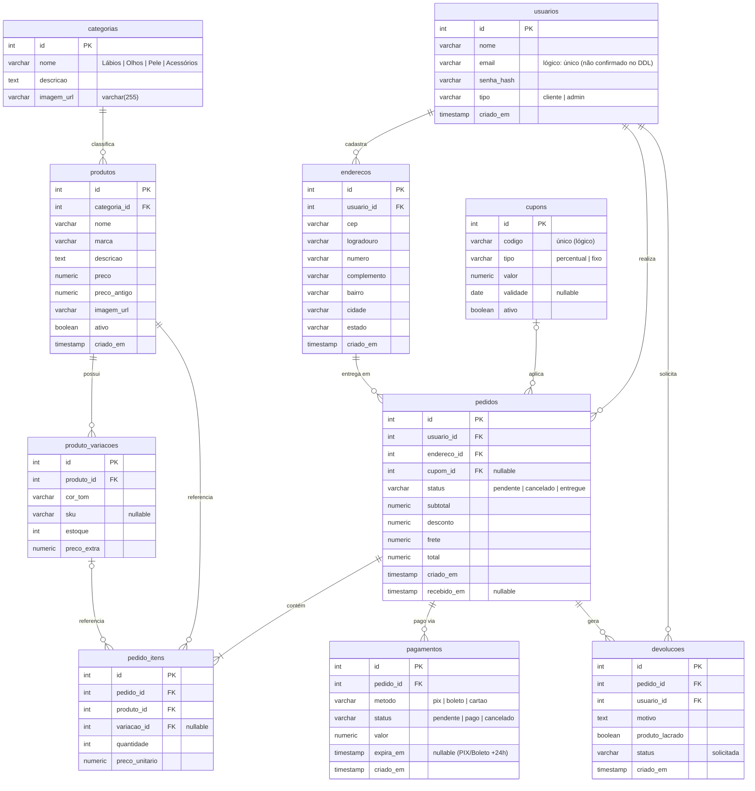

# Pink Glow — Diagrama de Entidade e Relacionamento (DER)

Banco: **PostgreSQL** (`pinkglow`) — stack PHP 8 + PDO.
Fonte: reconstruído a partir de `README.md`, `migrations/*.sql` e do código PHP em `public/`, `views/` e `scripts/`.

> **Observação:** o arquivo `SQL/sql.sql` é legado (MySQL, banco `sistema_maquiagem`) e **não** reflete o schema em produção — nele `produtos` tem uma coluna de texto `categoria`, enquanto o sistema real usa a FK `categoria_id` → `categorias.id`.

## Diagrama

## Legenda dos relacionamentos

| Relação | Cardinalidade | Coluna de ligação | Confirmação |
|---|---|---|---|
| categorias → produtos | 1:N | `produtos.categoria_id` | confirmado (JOIN) |
| produtos → produto_variacoes | 1:N | `produto_variacoes.produto_id` | confirmado (JOIN) |
| usuarios → enderecos | 1:N | `enderecos.usuario_id` | confirmado (JOIN) |
| usuarios → pedidos | 1:N | `pedidos.usuario_id` | confirmado (JOIN) |
| enderecos → pedidos | 1:N | `pedidos.endereco_id` | inferido (nome/INSERT) |
| cupons → pedidos | 1:N (opcional) | `pedidos.cupom_id` (nullable) | inferido |
| pedidos → pedido_itens | 1:N | `pedido_itens.pedido_id` | confirmado (JOIN) |
| produtos → pedido_itens | 1:N | `pedido_itens.produto_id` | confirmado (JOIN) |
| produto_variacoes → pedido_itens | 1:N (opcional) | `pedido_itens.variacao_id` (nullable) | confirmado (JOIN) |
| pedidos → pagamentos | 1:N | `pagamentos.pedido_id` | confirmado (JOIN) |
| pedidos → devolucoes | 1:N | `devolucoes.pedido_id` | inferido |
| usuarios → devolucoes | 1:N | `devolucoes.usuario_id` | confirmado |

## Regras de negócio ligadas ao modelo

- **RN01** — Estoque controlado em `produto_variacoes.estoque`; disponibilidade do produto = `SUM(estoque)` das variações.
- **RN02** — `pagamentos` (PIX/Boleto) com `expira_em` +24h e `status = 'pendente'` → `pedidos.status = 'cancelado'` (script `scripts/cancelar_pedidos_expirados.php`).
- **RN03** — Devolução em `devolucoes` validada pelo trigger `trg_devolucoes_rn03` (usa `pedidos.recebido_em` e prazo de 7 dias).

## Índices e objetos

- `idx_produtos_marca` em `produtos (marca)` — `migrations/001_produtos_marca.sql`.
- Trigger `trg_devolucoes_rn03` — citado em `public/devolucao.php`.

## Ressalvas

1. **Sem DDL completo no repositório.** O único `CREATE TABLE` existente é o legado MySQL em `SQL/sql.sql`. Tipos, tamanhos, nulabilidade, `UNIQUE` (ex.: `usuarios.email`, `cupons.codigo`) e `ON DELETE` foram inferidos — não há `ADD CONSTRAINT` visível.
2. `pagamentos.id` como PK foi inferido (nunca selecionado explicitamente no código).
3. `documentação projeto.pdf` não pôde ser lido — pode conter o DDL oficial; vale conferir.
